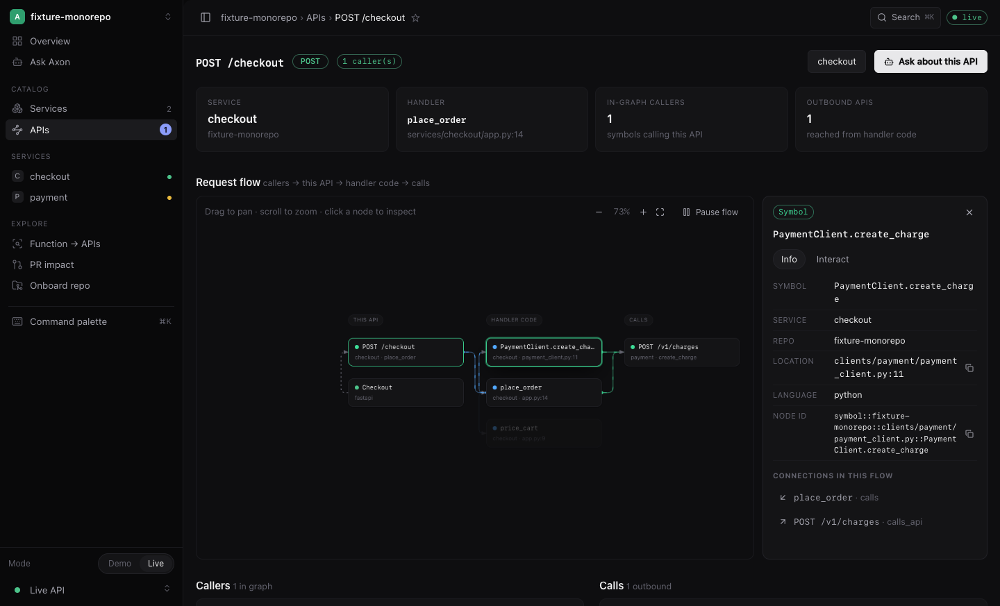

# Axon

[](https://github.com/Harshal96/axon/actions/workflows/ci.yml)
[](LICENSE)

**API-first code graph.** Axon indexes services by parsing code — no Bazel,
no build system — and lets you explore one API at a time: its handler call
graph, the APIs it calls, and who calls it. A natural-language ask endpoint
answers questions like "can this API be deprecated?" from graph evidence
only, with citations. A GitHub Action reports which services and APIs a
pull request affects.


Axon is pre-1.0 and local-first. The default API is meant for a trusted
developer machine; see [Security notes](#security-notes) before exposing it
to any network.

## Quick start

Prerequisites: Python 3.11+ with [`uv`](https://docs.astral.sh/uv/). The
web UI additionally needs Node.js 22+ and npm. Docker is optional and only
needed for the Neo4j-backed store.

```bash
git clone https://github.com/Harshal96/axon.git
cd axon
uv sync --dev

# Terminal 1: API (in-memory store; no DB needed for a first look)
uv run axon-server

# Terminal 2: index a repo that has an axon.yaml, then ask questions.
# The CLI talks to the API server (default http://localhost:8080; use
# `uv run axon configure --api-url <url>` for a hosted server). Indexing
# runs as a server job with live progress; Ctrl-C detaches and
# `axon jobs watch <id>` reattaches. Re-indexing the same commit is
# skipped unless --force. `--local` indexes in-process instead.
uv run axon index --repo /path/to/repo
uv run axon ask "What services does POST /checkout call?" --repo /path/to/repo

# Web UI (proxies /api to :8080; says "API unreachable" if the server is down)
cd web && npm ci && npm run dev   # http://127.0.0.1:5174

# Note: on versions before the parse-diagnostics fix, indexing a repo
# whose code contains invalid escape literals (e.g. "\d") floods stderr
# with SyntaxWarning lines from the indexed code. They do not affect
# the graph. Temporary workaround: prefix commands with
# PYTHONWARNINGS=ignore::SyntaxWarning (Python 3.12+).

# Optional: standalone demo build with fixture data, no backend needed.
# Demo is a separate build — the main build contains no demo data.
cd web && npm run dev:demo
```



With Neo4j (persistent graph + model-drafted Cypher execution):

```bash
docker compose up -d            # Neo4j + API (AXON_STORE=neo4j)
uv run axon-init                # v2 constraints/indexes
# Large monorepos: raise the heap (default 2g) or Neo4j runs out of memory:
# AXON_NEO4J_HEAP_MAX=4g docker compose up -d
```

## Onboard a repo (monorepo or small repo)

```bash
uv run axon init --repo /path/to/repo          # drafts axon.yaml + review notes
uv run axon init --repo /path/to/repo --write  # write the draft; review via PR
uv run axon init --repo /path/to/repo --ai     # opt-in: LLM drafts client targets/specs (needs LLM_* configured)
uv run axon index --repo /path/to/repo
```

`axon.yaml` declares services anywhere in the repo (roots/globs), specs,
generated clients (including swagger clients not connected by any build
file), shared libraries, and manual link overrides. Schema:
`axon.schema.json`. Agent workflow: `.agents/skills/axon-onboard/SKILL.md`.

The scan finds services at any depth (under `services/`, outside it, or
nested inside other services). It anchors on `swagger`/`openapi` specs
wherever they sit inside a service, app bootstraps, and framework
signals, then infers each service root from boundary markers and prints
the evidence per service. Duplicate specs and copies under client/test
folders do not become services, and `.worktrees/` is never scanned. If
the repo already has a service or resource registry in some other
format, point the onboard skill at it (for example "use `code_registry`
to get the list of services") and the agent translates it into
`axon.yaml`, cross-checked against the scan.

## PR impact

```bash
uv run axon pr-impact --repo . --base origin/main --head HEAD
```

For other repos, copy `examples/github-actions/axon-impact.yml` into
`.github/workflows/`. This repo's own workflow is
`.github/workflows/axon-impact.yml`.

## MCP

The separately packaged `axon-mcp/` adapter exposes the running Axon API to
MCP clients over stdio: `axon_search`, `axon_services`, `axon_api_graph`,
`axon_function_apis`, and `axon_ask`.

Start the API, save the adapter configuration, and register the stdio server
with Claude Code:

```bash
uv run axon-server
uv run --project axon-mcp axon-mcp configure --api-url http://localhost:8080
uv run --project axon-mcp axon-mcp serve
```

`configure` writes `~/.axon/config.json` and adds an `axon` entry to
`~/.claude.json`. For another MCP client, use the equivalent stdio command:

```json
{
  "mcpServers": {
    "axon": {
      "command": "uv",
      "args": [
        "run",
        "--project",
        "/path/to/axon/axon-mcp",
        "axon-mcp",
        "serve"
      ]
    }
  }
}
```

If the API uses `API_AUTH_MODE=dev`, pass the same bearer token to
`configure --token`. See [`axon-mcp/README.md`](axon-mcp/README.md).

## Ask model (optional)

Deterministic questions (callers, outbound APIs, deprecation,
function→APIs) need no model. For open questions, configure any
OpenAI-compatible endpoint — a locally hosted Hugging Face model
(for example `vllm serve <hf-model-id>`) or an external URL:

```bash
LLM_PROVIDER=local LLM_BASE_URL=http://localhost:8000 LLM_MODEL=<hf-model-id> \
  uv run axon-server
```

The model may only draft read-only Cypher; answers are synthesized from
executed rows. In the web Ask page and `POST /api/v2/ask`, choose
`Auto` (deterministic first), `Deterministic` (never calls a model), or
`Model` (draft a query with the configured server model). See
[`docs/v2.md`](docs/v2.md) for the full design, supported frameworks
(Django / FastAPI / Spring / Go / Vert.x), and limitations.

## Documentation

- [`docs/v2.md`](docs/v2.md) — graph model, parsers, stores, HTTP API, Ask,
  PR impact, onboarding, web UI, and MCP design
- [`docs/evals.md`](docs/evals.md) — per-language/framework parser evals and
  their coverage matrix
- [`web/README.md`](web/README.md) — frontend layers and rules
- [`axon-mcp/README.md`](axon-mcp/README.md) — MCP adapter setup and tools
- [`CONTRIBUTING.md`](CONTRIBUTING.md) — development setup and test tiers
- [`AGENTS.md`](AGENTS.md) — repository map and design invariants for agents

## Development

The fast, infrastructure-free checks are:

```bash
uv run pytest
uv run python -m tests.evals.harness
uv run ruff check axon/v2 axon/api/app.py cli tests/v2 tests/cli tests/evals
uv run mypy axon/v2 tests/evals
cd web && npm run typecheck && npm test && npm run build
```

`uv run pytest` includes the per-language/framework parser evals in
`tests/evals/` (Python/FastAPI, Python/Django, Java/Spring, Java/Vert.x,
Go, plus a pinned TypeScript known-gap case). The harness command prints
the same cases as a compact report; CI uploads it as a JSON artifact. See
[`docs/evals.md`](docs/evals.md).

See [`CONTRIBUTING.md`](CONTRIBUTING.md) for the complete gate, packaging
smoke test, and Neo4j-backed legacy integration tiers.

## Security notes

Axon is local-first. By default, API authentication is off, CORS is
permissive for local web development, and indexing endpoints accept paths
that the server process can read. Do not expose the default server directly
to an untrusted network. The Neo4j credentials in the Compose files are for
local development only. See [`SECURITY.md`](SECURITY.md).

## License

Axon is available under the [MIT License](LICENSE).
