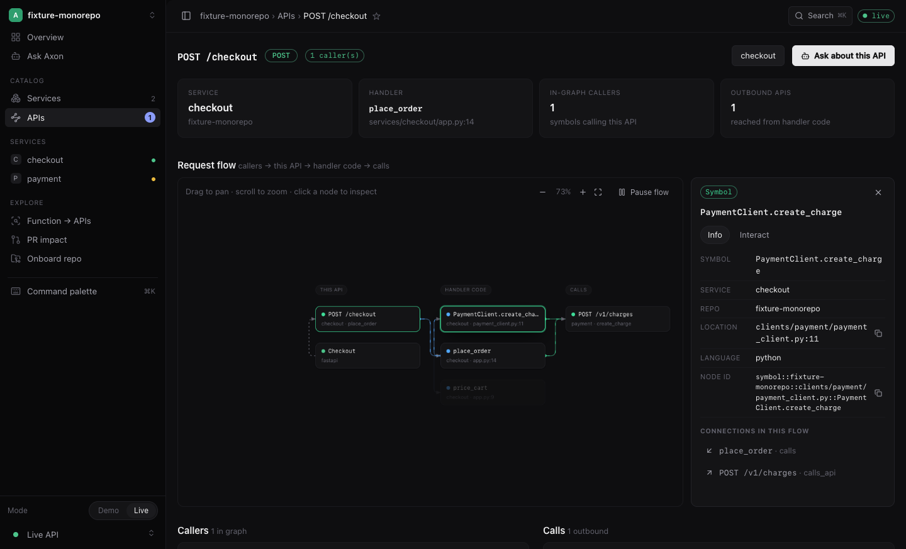

# Axon

[](https://github.com/Harshal96/axon/actions/workflows/ci.yml)
[](LICENSE)

**API-first code graph.** Axon indexes services by parsing code — no Bazel,
no build system — and lets you explore one API at a time: its handler call
graph, the APIs it calls, and who calls it. A natural-language ask endpoint
answers questions like "can this API be deprecated?" from graph evidence
only, with citations. A GitHub Action reports which services and APIs a
pull request affects.


Axon is pre-1.0 and local-first. The default API is meant for a trusted
developer machine; see [Security notes](#security-notes) before exposing it
to any network.

## Quick start

Prerequisites: Python 3.11+ with [`uv`](https://docs.astral.sh/uv/). The
web UI additionally needs Node.js 22+ and npm. Docker is optional and only
needed for the Neo4j-backed store.

```bash
git clone https://github.com/Harshal96/axon.git
cd axon
uv sync --dev

# Terminal 1: API (in-memory store; no DB needed for a first look)
uv run axon-server

# Terminal 2: index a repo that has an axon.yaml, then ask questions.
# The CLI talks to the API server (default http://localhost:8080; use
# `uv run axon configure --api-url <url>` for a hosted server). Indexing
# runs as a server job with live progress; Ctrl-C detaches and
# `axon jobs watch <id>` reattaches. Re-indexing the same commit is
# skipped unless --force. `--local` indexes in-process instead.
uv run axon index --repo /path/to/repo
uv run axon ask "What services does POST /checkout call?" --repo /path/to/repo

# Web UI (proxies /api to :8080; says "API unreachable" if the server is down)
cd web && npm ci && npm run dev   # http://127.0.0.1:5174

# Note: on versions before the parse-diagnostics fix, indexing a repo
# whose code contains invalid escape literals (e.g. "\d") floods stderr
# with SyntaxWarning lines from the indexed code. They do not affect
# the graph. Temporary workaround: prefix commands with
# PYTHONWARNINGS=ignore::SyntaxWarning (Python 3.12+).

# Optional: standalone demo build with fixture data, no backend needed.
# Demo is a separate build — the main build contains no demo data.
cd web && npm run dev:demo
```



With Neo4j (persistent graph + model-drafted Cypher execution):

```bash
docker compose up -d            # Neo4j + API (AXON_STORE=neo4j)
uv run axon-init                # v1 constraints/indexes
# Large monorepos: raise the heap (default 2g) or Neo4j runs out of memory:
# AXON_NEO4J_HEAP_MAX=4g docker compose up -d
```

## CLI distributions and agent skills

The workspace builds three separate distributions: `axon-core` contains static
parsers, graph models, local indexing and maintenance; `axon-cli` adds the `axon`
command and bundled skills; `axon` adds the FastAPI server and Neo4j dependency.
The CLI/core installation does not require FastAPI or Neo4j. Install the
`axon-cli[neo4j]` extra when using `--store neo4j` locally. Server entry points
remain `axon-server` and `axon-init`.

For this checkout, `uv sync --dev` installs the workspace and CLI. Once these
split distributions are released, standalone installation is
`uv tool install axon-cli` or `pipx install axon-cli`; publication and PyPI name
availability are separate release steps.

```bash
uv run axon skills list
uv run axon skills install --project --agent codex --repo /path/to/repo
uv run axon skills update --project --agent codex --repo /path/to/repo
```

Bundled `axon-onboard` and `axon-maintain` skills use local CLI commands for
configuration changes. Supported agents are Codex, Cursor, Claude and Devin;
use `--global` for user-wide installation. Updates refuse locally modified or
unmanaged skills unless explicitly forced. Installed skills carry `axon-version`
and an installation digest. The canonical sources live in `cli/skills/`.

## Onboard a repo (monorepo or small repo)

```bash
uv run axon init --repo /path/to/repo          # drafts axon.yaml + review notes
uv run axon init --repo /path/to/repo --write  # write the draft; review via PR
uv run axon init --repo /path/to/repo --ai     # opt-in: LLM drafts client targets/specs (needs LLM_* configured)
uv run axon index --repo /path/to/repo
```

`axon.yaml` declares services anywhere in the repo (roots/globs), specs,
generated clients (including swagger clients not connected by any build
file), shared libraries, and manual link overrides. Schema:
`axon.schema.json`. Agent workflow: `.agents/skills/axon-onboard/SKILL.md`.

The scan finds services at any depth (under `services/`, outside it, or
nested inside other services). It anchors on `swagger`/`openapi` specs
wherever they sit inside a service, app bootstraps, and framework
signals, then infers each service root from boundary markers and prints
the evidence per service. Duplicate specs and copies under client/test
folders do not become services, and `.worktrees/` is never scanned. If
the repo already has a service or resource registry in some other
format, point the onboard skill at it (for example "use `code_registry`
to get the list of services") and the agent translates it into
`axon.yaml`, cross-checked against the scan.

## Maintain a graph

Configuration mutations run in the local working tree and print diffs by
default. Use `--apply` after review; the server and MCP never write configuration,
except the API page's **Fix this API** correction apply, which writes the
previewed `axon.yaml` diff in the server's local checkout and re-checks just
that API (`axon index --repo . --api "GET /items"` does the re-check from the
CLI). Do not expose that endpoint beyond the local-first trust boundary.

```bash
axon service show payments --repo . --local --json
axon refs service payments --repo . --local --json
axon service patch payments --repo . --set 'base_urls=["env:PAYMENTS_URL"]'
axon client add ledger-sdk --repo . --service payments --target ledger --impact
axon api explain "POST /charge" --service payments --repo . --local --json
axon service remove payments --repo . --dry-run --impact
axon index --repo . --service payments --service ledger
axon doctor --repo .
axon verify --repo . --golden axon.golden.yaml
```

Exit codes distinguish success (0), invalid input (2), a choice required (3),
and a guard blocking the edit (4). Removing a service whose roots still exist
requires an explicit `--ignore-code` or `--leave-unowned` choice. Client removal
reports remaining code references before accepting `--force`. Cascades and
renames update related declarations and golden references; inspect their exact
diffs before applying. `--impact` indexes a temporary copy and reports outbound
deltas and unreviewed golden proposals; it does not publish a graph.

Use scoped `link`, `suppress`, `call`, `endpoint` and `handler` commands for
parser corrections. Declared calls require `--evidence file:line`, with the
source text captured by the CLI. Service-scoped indexing guarantees fresh
parsing of selected files and a focused report; resolution and publication
remain repository-wide. It does not promise faster indexing.
See [corrections and maintenance](docs/v1.md#corrections-and-maintenance) for
command details, overlay semantics and current static-analysis limits.

## Upgrade a graph

Persisted graphs carry a schema version. Before upgrading, run the read-only
preflight, and trial the new version next to the live graph:

```bash
uv run axon upgrade-check --repo . --snapshot graph.json --neo4j
uv run axon index --repo . --out graph-old.json   # with the old version
AXON_STATE_DIR=/tmp/axon-trial uv run axon index --repo . --local --out graph-new.json
uv run axon graph-compare --before graph-old.json --after graph-new.json
uv run axon verify --repo . --golden axon.golden.yaml --snapshot graph-new.json
```

A stale but readable graph serves reads and rebuilds at the next index. A
graph newer than the binary stops before any write, with the versions and the
fix in the error. Neo4j publishing keeps the previous generation:
`axon graph-rollback` flips back to it, and the first publish after a build
change writes a safety snapshot under the state dir. Full runbook:
[graph schema and upgrades](docs/v1.md#graph-schema-and-upgrades).

## PR impact

```bash
uv run axon pr-impact --repo . --base origin/main --head HEAD
```

For other repos, copy `examples/github-actions/axon-impact.yml` into
`.github/workflows/`. This repo's own workflow is
`.github/workflows/axon-impact.yml`.

## MCP

The separately packaged `axon-mcp/` adapter exposes the running Axon API to
MCP clients over stdio: `axon_search`, `axon_services`, `axon_api_graph`,
`axon_function_apis`, `axon_ask`, `axon_api_explain`, `axon_client_show`, and
`axon_refs`. Maintenance prompts are read-only; configuration changes belong
to the local CLI.

Start the API, save the adapter configuration, and register the stdio server
with Claude Code:

```bash
uv run axon-server
uv run --project axon-mcp axon-mcp configure --api-url http://localhost:8080
uv run --project axon-mcp axon-mcp serve
```

`configure` writes `~/.axon/config.json` and adds an `axon` entry to
`~/.claude.json`. For another MCP client, use the equivalent stdio command:

```json
{
  "mcpServers": {
    "axon": {
      "command": "uv",
      "args": [
        "run",
        "--project",
        "/path/to/axon/axon-mcp",
        "axon-mcp",
        "serve"
      ]
    }
  }
}
```

If the API uses `API_AUTH_MODE=dev`, pass the same bearer token to
`configure --token`. See [`axon-mcp/README.md`](axon-mcp/README.md).

## Ask service relationships

Ask “which APIs in scheduler call directory?” to see endpoint pairs and their
caller file/line evidence. Service IDs and display names come from your graph;
no repository-specific routing is used. Direct calls are the default; add
“indirectly” for transitive reachability. Empty results explain static-analysis
blind spots. Ambiguous names ask for clarification. For a code symbol, quote it
or say “function price_cart”. The web page shows compact navigable rows, with
interpretation and query details in disclosures.

## Ask model (optional)

Deterministic questions (callers, outbound APIs, deprecation,
function→APIs) need no model. For open questions, configure any
OpenAI-compatible endpoint — a locally hosted Hugging Face model
(for example `vllm serve <hf-model-id>`) or an external URL:

```bash
LLM_PROVIDER=local LLM_BASE_URL=http://localhost:8000 LLM_MODEL=<hf-model-id> \
  uv run axon-server
```

The model may only draft read-only Cypher; answers are synthesized from
executed rows. In the web Ask page and `POST /api/v1/ask`, choose
`Auto` (deterministic first), `Deterministic` (never calls a model), or
`Model` (draft a query with the configured server model). See
[`docs/v1.md`](docs/v1.md) for the full design, supported frameworks
(Django / FastAPI / Spring / Go / Vert.x), and limitations.

## Documentation

- [`docs/v1.md`](docs/v1.md) — graph model, parsers, stores, HTTP API, Ask,
  PR impact, onboarding, web UI, and MCP design
- [`docs/evals.md`](docs/evals.md) — per-language/framework parser evals and
  their coverage matrix
- [`web/README.md`](web/README.md) — frontend layers and rules
- [`axon-mcp/README.md`](axon-mcp/README.md) — MCP adapter setup and tools
- [`CONTRIBUTING.md`](CONTRIBUTING.md) — development setup and test tiers
- [`AGENTS.md`](AGENTS.md) — repository map and design invariants for agents

## Development

The fast, infrastructure-free checks are:

```bash
uv run pytest
uv run python -m tests.evals.harness
uv run ruff check axon/v1 axon/api/app.py cli tests/v1 tests/cli tests/evals
uv run mypy axon/v1 tests/evals
cd web && npm run typecheck && npm test && npm run build
```

`uv run pytest` includes the per-language/framework parser evals in
`tests/evals/` (Python/FastAPI, Python/Django, Java/Spring, Java/Vert.x,
Go, plus a pinned TypeScript known-gap case). The harness command prints
the same cases as a compact report; CI uploads it as a JSON artifact. See
[`docs/evals.md`](docs/evals.md).

See [`CONTRIBUTING.md`](CONTRIBUTING.md) for the complete gate, packaging
smoke test. Neo4j persistence needs separate live validation.

## Security notes

Axon is local-first. By default, API authentication is off, CORS is
permissive for local web development, and indexing endpoints accept paths
that the server process can read. Do not expose the default server directly
to an untrusted network. The Neo4j credentials in the Compose files are for
local development only. See [`SECURITY.md`](SECURITY.md).

## License

Axon is available under the [MIT License](LICENSE).


### Base URL ownership for raw HTTP calls

Declare environment variables, settings names or literal hosts on a service, or
on a generated client that already has a `target_service`:

```yaml
services:
  - id: app
    roots: [app]
    base_urls: [env:APP_URL, setting:APP_URL, app.example.test]
    clients:
      - id: sdk
        packages: [generated_sdk]
        target_service: remote
        base_urls: [env:REMOTE_URL]
  - id: remote
    roots: [remote]
```

Axon never reads these environment variables or executes configuration code.
Mappings scope method/path matching to the declared service. Unmapped symbolic
bases try unique method/path matches and retain their base reference and evidence.
Agreement across call sites promotes exact fallback links to INFERRED; conflicting
bases stay AMBIGUOUS, and path collisions stay external. Onboarding and doctor
print advisory mappings with counts and sample sites; nothing is silently written.
The index summary reports suppressed non-operation client members separately.

### Reproducible setup and regression checks

Service maps support `extends` and `overrides`, merging services, clients and correction lists by
id. Globs opt into team overlays; `{id: name, +delete: true}` removes inherited
rows without editing generated inputs. Keep reviewed changes in a committed overlay and use `{+append: [...]}`
when a list should grow instead of being replaced. Run `axon doctor --repo .`
before indexing, and `axon verify --repo . --golden axon.golden.yaml` to check
expected and forbidden outbound targets with source evidence. Index skips now
require an unchanged configuration fingerprint and a clean working tree.
See [configuration and golden-file format](docs/v1.md#configuration-overlays-and-setup-verification)
and the [committed registry generator pattern](examples/registry-onboarding/REGENERATE.md).


API index jobs also support persistent incremental state (`AXON_STATE_DIR`),
atomic graph deltas, queued-request coalescing and automatic golden checks.
`axon verify-index --repo . --snapshot graph.json` compares that state with a
read-only full rebuild; omit `--snapshot` to use the configured persistent store.
See [incremental behavior and conservative fallback limits](docs/v1.md#incremental-state-and-audit)
and the generic post-merge/nightly examples under `examples/`.

### Large repositories and reviewed graph samples

`axon init --refresh --repo .` prints a reviewable diff against existing effective
configuration, preserving curated ids, names, mappings, ignores, shared roots and
links. It does not overwrite files. Discovery collapses internal route packages
and container folders, and proposes route-free libraries as shared code.
`axon doctor --repo .` reports deployable applications hidden under shared roots.

```bash
axon verify-sample --repo . --services 5 --apis 5 --seed 42 --out review.json
# Set each reviewed row's verdict to ok, wrong-handler, false-edge or missing-edge.
axon verify-sample --repo . --services 5 --apis 5 --seed 42 \
  --review review.json --export-golden axon.golden.yaml
axon verify --repo . --golden axon.golden.yaml
```

Samples include the shortest symbol chain, source snippets, call sites, target
locations, confidence, rules and suspicious range flags. Only `ok` rows export
as golden expectations; review verdicts never automatically change the graph.
Use `--snapshot graph.json` to review a saved snapshot.

Neo4j uses bounded batches and generation publication for large replacements.
In development Compose, `AXON_NEO4J_HEAP_INITIAL`, `AXON_NEO4J_HEAP_MAX`,
`AXON_NEO4J_PAGECACHE` and `AXON_NEO4J_TX_MAX` configure heap, page cache and the
transaction cap. Defaults are 512m, 2g, 1g and 1g respectively. For example:

```bash
AXON_NEO4J_HEAP_MAX=4g AXON_NEO4J_PAGECACHE=2g AXON_NEO4J_TX_MAX=2g docker compose up -d
uv run axon-init
```

Choose values within the host's available RAM; resource-limit errors identify
the batch and relevant settings. These are development settings and credentials.
The default API is unauthenticated and must remain on a trusted local network.
`/health` reports warmup; jobs persist in `$AXON_STATE_DIR/jobs.db` and incomplete
jobs become interrupted after restart. Progress reports publish and state phases.

`uv run python -m tools.benchmark_scale --files 30000 --symbols 10 --out scale.json`
generates a generic Python/Java/Go repository and records phase times, peak RSS,
Python allocation peak, state size, unchanged re-index and a 1% edit. Use
`--store neo4j` for a configured development database. The nightly benchmark
workflow uploads measurements; it does not imply a measured production budget.


The Functions → APIs catalog opens with ranked static reach from indexed API
handlers. Filter by repository, services using a function, definition owner or
symbol kind; inspect shortest call paths and direct caller evidence. These
counts describe indexed code, not runtime traffic. API clients can use
`GET /api/v1/functions` (faceted, paginated catalog),
`GET /api/v1/functions/{symbol_id}` (evidence), and the compatible
`GET /api/v1/functions/apis?q=` lookup. See [v1 API details](docs/v1.md).
